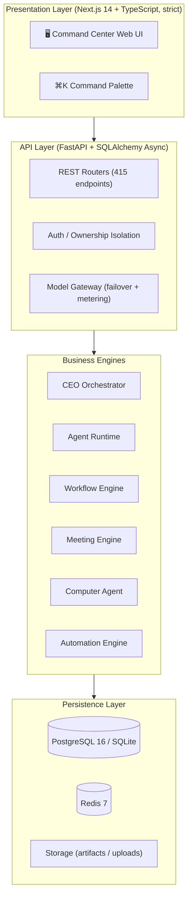

<div align="center">

# 🏢 AI-EOS

**The AI-Native Enterprise Operating System — Found an AI Company, Hire Digital Employees, Delegate Work**

[](#-latest-v5130)
[](LICENSE)
[](https://www.python.org/)
[](https://fastapi.tiangolo.com)
[](https://nextjs.org/)
[](#-quick-start)
[](#-testing)

<p align="center">
  <b>One Command. A Whole Company at Work.</b><br>
  <i>一声令下，全公司为你开工</i>
</p>

**English** • [简体中文说明](README_ZH.md)

[✨ Features](#-core-features) • [🚀 Quick Start](#-quick-start) • [🏗️ Architecture](#-system-architecture) • [🧪 Testing](#-testing) • [📦 Latest](#-latest-v5130) • [📜 License](#-license--copyright-terms)

</div>

---

## 💡 Why AI-EOS?

AI chatbots answer questions — but the work still lands on your desk. Meanwhile:

1. **Chatbots don't do work**: They produce text; you still execute, follow up, and coordinate everything yourself.
2. **Real teams are expensive**: A small business owner can't hire a research team, a content team, and an ops team just to move faster.
3. **Agent tools are single-threaded**: Most "AI agent" products are one prompt box with no organization, no division of labor, no audit trail — you can't trust them with real work.

**AI-EOS is not a chatbot. It's a digital-employee work platform.** You found an AI company, hire digital employees (Agents) into departments, give each one a role, a model, and skills — then issue a task. A CEO agent decomposes it, dispatches subtasks to employees working in parallel, lets them discuss, and consolidates the results. You watch the whole process live, and can pause, intervene, or take over at any moment.

---

## ✨ Core Features

### 1. 🏢 Run It Like a Real Company
- **Companies → Departments → Employees**: a clear org tree, just like a real business.
- Every employee is a full profile: name, title, department, manager, persona (system prompt), and one of 6 states (idle / working / paused / error / disabled / online).
- **Employee lifecycle**: hiring from templates, training proposals with approval & rollback, performance reviews, promotions, transfers, and offboarding handover.

### 2. 🤖 CEO Task Orchestration
- Issue one task from the Command Center — the CEO agent **decomposes it, dispatches subtasks in parallel, and consolidates a final report**.
- Batch dispatch to a single agent, a list, a whole department, or the entire company; batch delete, batch reprioritize, and one-click global interrupt.
- **Failed tasks are retryable** (`POST /tasks/{id}/retry`); pause actually resumes from checkpoints; stuck tasks self-heal on restart.

### 3. 👥 AI Meeting System
- Multi-round meetings with user interjection, auto-generated minutes, and action items that convert into tasks with one click.

### 4. 🖥️ Computer Agent (Real Desktop Automation)
- Takes real screenshots, types and clicks for real via a guarded sandbox: binary allowlist, path sandboxing, dry-run by default for destructive commands. **Currently implemented on macOS** (`screencapture` + `osascript` + `open`); Windows/Linux execution is not wired up yet.

### 5. 🔌 Model Gateway with Failover & Metering
- **Primary → secondary → fallback** automatic failover across providers (OpenAI-compatible, Anthropic, Gemini — plus a plugin directory for more).
- **Six-dimensional token metering** (company / department / agent / project / task / scenario) with cost snapshots — the raw material for chargeback and pricing.

### 6. 🧠 Knowledge Base, Workflow Builder & Automation
- Knowledge base with **keyword-overlap retrieval** over your documents (bigram token scoring, candidate-capped in SQL — not vector/pgvector yet; `/knowledge/rag` injects the retrieved chunks into a prompt rather than doing embedding search); a drag-and-drop **workflow canvas** (nodes, edges, run with live polling); an automation engine with scheduled triggers.

### 7. 🛡️ Security & Tenancy Done Seriously
- Login rate limiting (Redis-backed, falls back to in-process counters when Redis is down), password policy, bcrypt hashing, **refresh-token rotation with revocation**, and 404-instead-of-403 on authorization failures to prevent ID enumeration.
- **JWT secret is never a public constant**: an empty or placeholder `JWT_SECRET` triggers generation of a random secret that is persisted to disk (or held in memory with a loud warning if the directory is read-only). In production (`AIEOS_ENV=production`) an insecure secret **refuses to boot** rather than self-healing silently.
- **The desktop app binds `127.0.0.1` by default** — LAN sharing is an explicit toggle that rebinds to `0.0.0.0` and restarts the backend. `/docs`, `/redoc` and `/openapi.json` exist only under `DEBUG=true`; `/metrics/prometheus` requires `METRICS_TOKEN` or a loopback peer.
- Capability × role matrix as a single source of truth; per-route ownership checks. *Note:* the matrix defines OWNER/ADMIN/MEMBER/VIEWER, but multi-member companies aren't open yet — `resolve_role` currently returns OWNER for the company owner and nothing else, so treat today's isolation as **per-user**, not shared-org tenancy.

### 8. 🎭 Onboarding for Humans
- A 3-step wizard (about 1 minute), a **keyless demo mode** to try before configuring models, Chinese actionable error messages, and a ⌘K command palette with pinyin search.
- **One screen for everything**: `/workspace` is the only shell. Sidebar, ⌘K and in-page links open features as **tabs in the right panel** while the chat and left rail stay put; old direct URLs redirect into the workbench (tabs are closable, restored on reload, and go full-screen on narrow viewports).

---

## 🏗️ System Architecture



**Scale (measured from source, v5.13.0)**: backend 31,893 lines / 168 files / 420 operations over 365 paths / 104 tables / 32 Alembic migrations; frontend 24,938 lines / 47 page routes; backend suite **324 passed** (plus 38 e2e checks).

> Two honest caveats, because "it works" and "it's been verified" are different claims:
> - **`alembic upgrade head` is PostgreSQL-only.** One historical migration (`23e9b97bb927`) hits SQLite's
>   `No support for ALTER of constraints`. The desktop/portable form never relies on Alembic — schema
>   evolution there goes through `create_all` + idempotent `ensure_columns`, so existing SQLite databases
>   upgrade on first start. Only the server deploy path (Postgres) uses Alembic.
> - **`plugins/skills/`, `plugins/providers/`, `plugins/models/` and `packages/*` ship empty.** The dynamic
>   loading *code* is real and runs, but there are no bundled plugins yet — don't judge the extension
>   system by an installed file list.

---

## 🚀 Quick Start

### System Requirements
- **Python**: 3.12+
- **Node.js**: 18+ (frontend)
- **OS**: macOS / Linux / Windows
- **Optional**: PostgreSQL 16 + Redis 7 (Docker compose covers both; SQLite works out of the box)

### Local Setup

```bash
# 1. Clone
git clone https://github.com/yimuhub/ai-eos.git
cd ai-eos

# 2. Configure (copy the template and fill in your model API keys)
cp .env.example apps/api/.env

# 3. Backend
cd apps/api
uv sync
uv run uvicorn app.main:app --host 127.0.0.1 --port 8001

# 4. Frontend (new terminal)
cd apps/web
npm install
npm run dev
```

Open **`http://localhost:3000`**, then **register an account on the login page** (no preset accounts — the first registration is yours).

> 💡 No API key yet? The onboarding wizard offers a **keyless demo mode** (one demo employee + one sample task) so you can feel the product before configuring any model.

### 📦 Portable Launchers (Double-Click)

- **macOS**: double-click `packaging/start-mac.sh` (installs deps on first run, snapshots `data/` before start)
- **Windows**: double-click `packaging/start-win.bat`
- **Linux**: run `./packaging/start-linux.sh` in a terminal (same standard as macOS: auto-installs deps, snapshots `data/`, appends logs)

### 🐳 Docker

```bash
cd docker && docker compose up -d
```

### 🌐 Server One-Click Deployment

On a fresh Linux server (Ubuntu / Debian / CentOS / Rocky / Alpine):

```bash
git clone https://github.com/yimuhub/ai-eos.git
cd ai-eos
chmod +x 服务器一键部署.sh && ./服务器一键部署.sh
```

The script installs system dependencies, pulls the code (the repo is private — have a GitHub personal access token ready), sets up the backend (`uv sync`, auto-generated `.env` with a random `JWT_SECRET`, `alembic upgrade head`) and the frontend (`npm install && npm run build`), then registers and starts the `ai-eos-api` / `ai-eos-web` systemd services. When finished, open `http://<server-ip>:8000`.

---

## 🧪 Testing

```bash
cd apps/api && uv run pytest        # 171 passed, 1 skipped
cd apps/web && npm run test          # vitest (frontend)
```

> ⚠️ When running `test_auth.py`, **do not start a local Redis** — the test asserts on the in-memory rate-limit dict, and a live Redis would route limiting through the Redis path instead.

---

## 📦 Latest: v5.13.0

*One interface, streaming answers: every feature opens as a tab inside the workbench — 2026-10-30. Full entry in [`CHANGELOG.md`](CHANGELOG.md).*

- 🧩 **One interface for everything.** `/workspace` is now the only shell. The left rail, ⌘K and every in-page entry open features as **closable tabs in the right panel** — the chat and rail never navigate away. Tabs stay mounted (filters and scroll survive), closing one activates its left neighbour, and state is restored after a reload.
- 🔗 **Old links still work.** Visiting `/tasks`, `/knowledge` and friends redirects into `/workspace?app=…`, so bookmarks, refreshes and pasted links always land in the same interface. On narrow screens the panel goes full-screen and the left drawer steps aside.
- ⌨️ **Shortcuts never get swallowed.** ⌘K / ⌘B / ⌘J / ⌘N pressed while the focus is inside an embedded page are forwarded to the shell, so the command palette behaves the same everywhere.
- 🌊 **Token streaming.** New `POST /agents/{id}/chat/stream` (SSE `status` / `delta` / `done` / `error`); gateway `stream()` downgrades automatically when a server rejects `stream_options`, and failover only happens **before** the first token so two models never mix text. Both the workbench chat and the employee chat render token by token with a caret, a stop button and an honest "this round was not saved" note.
- 🚚 **Routing and desktop shell.** The command deck moved to `/dashboard`; the mac shell uses `hiddenInset` with a 34px drag strip. The old global sidebar shell was deleted so only one navigation model remains.
- 🧪 Backend suite **324 passed**; `./tools/check.sh --fast` fully green (contracts / tsc strict / eslint), `next build` renders all 47 routes, plus browser walkthroughs for the tab flow, redirects, reload restore and the 390px layout.

### Previous: v5.12.0

*The "one-person company" loop, closed: one sentence in, whole company working, results out — 2026-10-29. Full entry in [`CHANGELOG.md`](CHANGELOG.md).*

- 👑 **One-sentence direct run.** New `POST /command/run` fuses planning and execution with no intermediate confirmation. DIRECT dispatches tasks straight into the queue; PROJECT skips per-member announcements and leader acknowledgement and starts work. The command deck gains a **⚡ one-sentence run** button while keeping the two-step "review the plan first" path.
- 🚀 **Dispatch actually starts work.** Fixes "assign to the whole company" producing N permanently idle TODOs: a persistent `auto_start` marker plus a durable queue (`app/task_runner.py`) with CAS starts; when every worker is busy the task returns to TODO *with the marker kept*, and the scheduler loop picks it up by URGENT/HIGH/NORMAL priority — no RUNNING rows without a worker.
- 🔧 **Agents can actually fetch data.** The task runtime now ships real tools (`web_search` / `web_fetch`) through OpenAI function-calling, with a text-form fallback for weaker models, bounded multi-round calls, truncated tool results and a `tools_used` trace — "can browse the web" is no longer prompt-only fiction.
- 📊 **Reports are deliverable.** Five professional report skeletons (industry research, business analysis, weekly report, project review, proposal); Word renders real tables and East-Asian fonts, Excel gets multi-sheet output with numeric cells, frozen headers and autofilters, PowerPoint gets native tables and one slide per section.
- 🕘 **Briefing numbers match the timezone.** Yesterday/today/today-cost windows now convert local midnight to naive UTC, and a crash from a non-existent `company.created_by` field is gone.
- 🛡 **Tightened.** Automation `call_webhook` gained the SSRF gate (including a post-connect peer check); dispatching now filters targets by company, so cross-tenant assignment is impossible.
- 🧪 34 new backend tests (document rendering, auto-dispatch queue, tool loop, one-sentence run, briefing, webhook SSRF); suite 261 → **295**; `./tools/check.sh` fully green (contracts / tsc / eslint / 38 e2e checks).

### Previous: v5.11.0

*Second hardening pass, organized by technical direction — 2026-10-28.*

Full entry in [`CHANGELOG.md`](CHANGELOG.md); the review is [`docs/审查报告_AI-EOS_2026-10-28.md`](docs/审查报告_AI-EOS_2026-10-28.md).

- 🚪 **Cross-tenant read leaks driven to zero.** 15 endpoints that probing had confirmed as *actually readable* (experts, collaboration, schedules, memory, governance, skills, automations, review cycles) now enforce ownership. The static debt register shrank from 52 to **1 known false positive**, and the guard now understands router-level `require_company_scope`.
- ⚙️ **Concurrency correctness.** SQLite `busy_timeout`/WAL/foreign keys, CAS on approval decisions and task transitions, commit-before-dispatch, meeting/workflow leases — 20 concurrent requests no longer hit `database is locked`, and side effects fire once.
- 🌐 **Outbound safety.** Model configs can no longer reference server secrets such as `JWT_SECRET` (blocked on write **and** at resolution time, so legacy rows can't exfiltrate either); SSRF checks every redirect hop; webhooks/scrapes no longer echo upstream bodies.
- ⚡ **Performance.** Homepage's three serial requests merged into `/dashboard/{id}/bootstrap` (`GROUP BY` counts, `limit 20`, 5s→15s polling); task detail polls `/tasks/{id}/summary` (no `result` body, outputs truncated to 2KB); war room uses an incremental snapshot; RAG narrows candidates in SQL first; group chat sets `max_tokens=512` with per-company concurrency limits.
- 📤 **Uploads & plugins.** 1MB-chunk streaming with a 25MB cap, extension allowlists and server-generated names; skill plugins drop `sys.path.insert` for unique module names and manifest/path validation.
- 🧪 **Test effectiveness.** Coverage gate in CI (routes+core at 35%, threshold 30), lifespan executed for the first time, guard tests reverse-verified; suite grew 171 → **261**.

### Previous: v5.10.0

*Security & correctness hardening — 2026-10-27.*

Full entry in [`CHANGELOG.md`](CHANGELOG.md); the review that produced it is in
[`docs/检测报告_AI-EOS_2026-10-27.md`](docs/检测报告_AI-EOS_2026-10-27.md).
Every item below was **reproduced first, then fixed, then re-verified by attack probe** — not "reviewed and patched":

- 🔑 **JWT empty/placeholder secret could forge tokens.** An empty key still signs valid tokens *and* verifies them. Now a random secret is generated and persisted; in production an insecure secret refuses to boot. Forgery with `""` / the committed placeholder: **5/5 rejected**.
- 🚪 **Cross-tenant reads.** Write paths were guarded; read paths mostly weren't — another company's `company_id` listed its artifacts, KB docs, policies and whitelists. **31/31 attack probes now blocked, 0 owner false positives**, plus an AST guard test with a *shrink-only* debt register.
- 🗄 **Publish never worked on SQLite.** `SET published_at = NOW()` (no such function) — and the column didn't exist in the model at all. Fixed with bound params + naive UTC; column added to the model, as an Alembic migration, and via idempotent startup backfill. Verified end-to-end `submit → approve → publish`, idempotent.
- 🖥 **Desktop bound to `0.0.0.0` unconditionally.** Now `127.0.0.1` by default with an explicit LAN-share toggle (which also gates mDNS advertising); `/docs` + `/openapi.json` only exist under `DEBUG`; `/metrics` needs a token or loopback.
- ⚙️ Budget resume case mismatch (raising the cap couldn't resume work), naive-vs-aware UTC day windows, workflow agent-node failures that hung forever, dead code in meeting-minutes extraction, blocking `urlopen` → async, and **silent `except: pass` cleared to zero**.
- 🧨 Version strings disagreed across six places (`0.1.0` / `5.9.0` / `5.0.0` / `4.1.0` / `5.4`); now one source of truth + a consistency test.
- 🛡 New CI gates: backend pytest (explicitly **no Redis** — `test_auth` asserts the in-memory fallback), `tsc --noEmit`, vitest, and a hardened OpenAPI contract check that no longer green-lights misspelled actions.

### Phase 3 + 2026-10-14 hardening

**Phase 3** delivered the agent growth system (learning, performance reviews, skill marketplace, external agent onboarding, Computer Agent).

The **2026-10-14 hardening pass** (full report in `CHANGELOG.md`) fixed every P0 from an independent five-perspective code review:

- 🔁 Task retry endpoint, true resume-from-checkpoint, stuck-task self-healing, per-type timeouts (no more 600s death line)
- 🔌 Model gateway circuit breaker + cooldown, failover logging, failure-aware metering
- 🔑 Refresh-token rotation with revocation, Redis-backed login rate limiting, AST-level silent-exception guard
- 🧩 Real plugin loading for `plugins/skills/` and `plugins/providers/`
- 📦 Fixed portable launchers, `.env.example`, backup runbook, production-ready Docker compose
- ⚖️ Licensed under **BSL 1.1**

---

## 📡 V5.x LAN Sharing & Device Pairing

Beyond cloud SaaS, AI-EOS runs as a **local LAN office**:

- **LAN sharing (V5.3, rebound by default since V5.10)**: the desktop backend listens on `127.0.0.1` unless you turn on **📡 局域网共享**, which rebinds it to `0.0.0.0` and restarts the backend — and turns mDNS advertising on with it. The page shows your LAN IP, a QR code (phone scans → straight into the responsive Web UI), and the API endpoint for the Android app. Optional **auto-launch at login** (macOS/Windows login items, Linux XDG autostart).
- **Pairing & device authorization (V5.4)**: instead of typing passwords on a phone, generate a **one-time pairing code** (10-minute TTL, single-use, hashed in DB) from the LAN-sharing page; scanning it registers the phone as a *device* and hands it a scoped token pair. Every connected device shows up in **已授权设备** and can be **revoked in one click** — revocation kills all of that device's refresh tokens instantly.
- **mDNS discovery (V5.4)**: while running, the service announces itself on the local network as `ai-eos-<port>._aieos._tcp.local.` (zeroconf, degrades silently when unavailable; `AI_EOS_MDNS=0` disables it).
- **🩺 Diagnostics (V5.4)**: one-click health check — DB latency, disk space, LAN reachability, update-channel manifest, stuck executions — with a suggested fix for every failing item.

---

## 🏢 V5.5 One-Person Company Upgrades (P0)

Per the industry research in [`docs/调研报告_Agent公司与一人公司_2026-10.md`](docs/调研报告_Agent公司与一人公司_2026-10.md), AI-EOS now covers the three highest-leverage gaps that let **one human run a real AI company** safely:

- **🌅 CEO Morning Briefing**: the dashboard opens with *yesterday's results / today's plan / decisions that need you* plus a live cost chip — all derived from existing audit data (`GET /briefing`, zero new tables).
- **🖥 High-risk action approval gate**: with the switch on, agents must get the boss's approval before running **shell commands / file writes / app launches**; approving auto-executes the pending command, rejecting discards it (two-layer defense: capability grant **and** boss approval).
- **🛡 Token budget cap**: set daily/total token or ¥ limits per company or per agent; when the ceiling is hit, work **pauses** (no punitive overage pricing), and raising the limit instantly resumes execution. Managed on the Token-Stats page's new *预算上限* tab.

---

## 📜 License & Copyright Terms

- **Copyright Entity & Licensor**: eos.hyipf.com
- **License**: **Business Source License 1.1 (BSL 1.1 / BUSL-1.1)**

### 📄 Commercial Terms & Use Grant
- 🎁 **Free tier**: personal learning and research, non-commercial use, and **internal use by teams of no more than 3 people** — 100% free, no authorization needed.
- 💼 **Commercial licensing**: use beyond the free tier — including use by **teams larger than 3 people**, or **deploying on cloud/public servers or offering as a SaaS service** — requires a commercial license (register at `eos@hyipf.com`).
- 🔄 **Automatic open-source conversion**: each version automatically converts to **Apache License 2.0** four years after its release date.

For full legal terms, read [LICENSE](LICENSE).

---

<div align="center">
  <sub>Copyright © 2026 eos.hyipf.com · All rights reserved.</sub>
</div>
