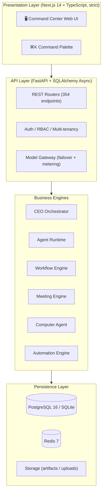

<div align="center">

# 🏢 AI-EOS

**The AI-Native Enterprise Operating System — Found an AI Company, Hire Digital Employees, Delegate Work**

[](#-latest-phase-3--2026-10-14-hardening)
[](LICENSE)
[](https://www.python.org/)
[](https://fastapi.tiangolo.com)
[](https://nextjs.org/)
[](#-quick-start)
[](#-testing)

<p align="center">
  <b>One Command. A Whole Company at Work.</b><br>
  <i>一声令下，全公司为你开工</i>
</p>

**English** • [简体中文说明](README_ZH.md)

[✨ Features](#-core-features) • [🚀 Quick Start](#-quick-start) • [🏗️ Architecture](#-system-architecture) • [🧪 Testing](#-testing) • [📦 Latest](#-latest-phase-3--2026-10-14-hardening) • [📜 License](#-license--copyright-terms)

</div>

---

## 💡 Why AI-EOS?

AI chatbots answer questions — but the work still lands on your desk. Meanwhile:

1. **Chatbots don't do work**: They produce text; you still execute, follow up, and coordinate everything yourself.
2. **Real teams are expensive**: A small business owner can't hire a research team, a content team, and an ops team just to move faster.
3. **Agent tools are single-threaded**: Most "AI agent" products are one prompt box with no organization, no division of labor, no audit trail — you can't trust them with real work.

**AI-EOS is not a chatbot. It's a digital-employee work platform.** You found an AI company, hire digital employees (Agents) into departments, give each one a role, a model, and skills — then issue a task. A CEO agent decomposes it, dispatches subtasks to employees working in parallel, lets them discuss, and consolidates the results. You watch the whole process live, and can pause, intervene, or take over at any moment.

---

## ✨ Core Features

### 1. 🏢 Run It Like a Real Company
- **Companies → Departments → Employees**: a clear org tree, just like a real business.
- Every employee is a full profile: name, title, department, manager, persona (system prompt), and one of 6 states (idle / working / paused / error / disabled / online).
- **Employee lifecycle**: hiring from templates, training proposals with approval & rollback, performance reviews, promotions, transfers, and offboarding handover.

### 2. 🤖 CEO Task Orchestration
- Issue one task from the Command Center — the CEO agent **decomposes it, dispatches subtasks in parallel, and consolidates a final report**.
- Batch dispatch to a single agent, a list, a whole department, or the entire company; batch delete, batch reprioritize, and one-click global interrupt.
- **Failed tasks are retryable** (`POST /tasks/{id}/retry`); pause actually resumes from checkpoints; stuck tasks self-heal on restart.

### 3. 👥 AI Meeting System
- Multi-round meetings with user interjection, auto-generated minutes, and action items that convert into tasks with one click.

### 4. 🖥️ Computer Agent (Real Desktop Automation)
- Takes real screenshots, types and clicks for real via a guarded sandbox: binary allowlist, path sandboxing, dry-run by default for destructive commands.

### 5. 🔌 Model Gateway with Failover & Metering
- **Primary → secondary → fallback** automatic failover across providers (OpenAI-compatible, Anthropic, Gemini — plus a plugin directory for more).
- **Six-dimensional token metering** (company / department / agent / project / task / scenario) with cost snapshots — the raw material for chargeback and pricing.

### 6. 🧠 Knowledge Base, Workflow Builder & Automation
- Knowledge base with retrieval over your documents; a drag-and-drop **workflow canvas** (nodes, edges, run with live polling); an automation engine with scheduled triggers.

### 7. 🛡️ Security & Tenancy Done Seriously
- Login rate limiting (Redis-backed), password policy, bcrypt hashing, **refresh-token rotation with revocation**, and 404-instead-of-403 on authorization failures to prevent tenant ID enumeration.
- Capability × role matrix as a single source of truth; per-route ownership checks.

### 8. 🎭 Onboarding for Humans
- A 3-step wizard (about 1 minute), a **keyless demo mode** to try before configuring models, Chinese actionable error messages, and a ⌘K command palette with pinyin search.

---

## 🏗️ System Architecture



**Scale (measured from source)**: backend ~21,500 lines / 135 files / 354 endpoints / 94 tables / 28 Alembic migrations; frontend ~17,700 lines / 34 top-level pages; 158 backend test cases.

---

## 🚀 Quick Start

### System Requirements
- **Python**: 3.12+
- **Node.js**: 18+ (frontend)
- **OS**: macOS / Linux / Windows
- **Optional**: PostgreSQL 16 + Redis 7 (Docker compose covers both; SQLite works out of the box)

### Local Setup

```bash
# 1. Clone
git clone https://github.com/yimuhub/ai-eos.git
cd ai-eos

# 2. Configure (copy the template and fill in your model API keys)
cp .env.example apps/api/.env

# 3. Backend
cd apps/api
uv sync
uv run uvicorn app.main:app --host 127.0.0.1 --port 8001

# 4. Frontend (new terminal)
cd apps/web
npm install
npm run dev
```

Open **`http://localhost:3000`**, then **register an account on the login page** (no preset accounts — the first registration is yours).

> 💡 No API key yet? The onboarding wizard offers a **keyless demo mode** (one demo employee + one sample task) so you can feel the product before configuring any model.

### 📦 Portable Launchers (Double-Click)

- **macOS**: double-click `packaging/start-mac.sh` (installs deps on first run, snapshots `data/` before start)
- **Windows**: double-click `packaging/start-win.bat`
- **Linux**: run `./packaging/start-linux.sh` in a terminal (same standard as macOS: auto-installs deps, snapshots `data/`, appends logs)

### 🐳 Docker

```bash
cd docker && docker compose up -d
```

### 🌐 Server One-Click Deployment

On a fresh Linux server (Ubuntu / Debian / CentOS / Rocky / Alpine):

```bash
git clone https://github.com/yimuhub/ai-eos.git
cd ai-eos
chmod +x 服务器一键部署.sh && ./服务器一键部署.sh
```

The script installs system dependencies, pulls the code (the repo is private — have a GitHub personal access token ready), sets up the backend (`uv sync`, auto-generated `.env` with a random `JWT_SECRET`, `alembic upgrade head`) and the frontend (`npm install && npm run build`), then registers and starts the `ai-eos-api` / `ai-eos-web` systemd services. When finished, open `http://<server-ip>:8000`.

---

## 🧪 Testing

```bash
cd apps/api && uv run pytest        # 158 backend test cases
cd apps/web && npm run test          # vitest (frontend)
```

> ⚠️ When running `test_auth.py`, **do not start a local Redis** — the test asserts on the in-memory rate-limit dict, and a live Redis would route limiting through the Redis path instead.

---

## 📦 Latest: Phase 3 + 2026-10-14 Hardening

**Phase 3** delivered the agent growth system (learning, performance reviews, skill marketplace, external agent onboarding, Computer Agent).

The **2026-10-14 hardening pass** (full report in `CHANGELOG.md`) fixed every P0 from an independent five-perspective code review:

- 🔁 Task retry endpoint, true resume-from-checkpoint, stuck-task self-healing, per-type timeouts (no more 600s death line)
- 🔌 Model gateway circuit breaker + cooldown, failover logging, failure-aware metering
- 🔑 Refresh-token rotation with revocation, Redis-backed login rate limiting, AST-level silent-exception guard
- 🧩 Real plugin loading for `plugins/skills/` and `plugins/providers/`
- 📦 Fixed portable launchers, `.env.example`, backup runbook, production-ready Docker compose
- ⚖️ Licensed under **BSL 1.1**

---

## 📜 License & Copyright Terms

- **Copyright Entity & Licensor**: eos.hyipf.com
- **License**: **Business Source License 1.1 (BSL 1.1 / BUSL-1.1)**

### 📄 Commercial Terms & Use Grant
- 🎁 **Free tier**: personal learning and research, non-commercial use, and **internal use by teams of no more than 3 people** — 100% free, no authorization needed.
- 💼 **Commercial licensing**: use beyond the free tier — including use by **teams larger than 3 people**, or **deploying on cloud/public servers or offering as a SaaS service** — requires a commercial license (register at `eos@hyipf.com`).
- 🔄 **Automatic open-source conversion**: each version automatically converts to **Apache License 2.0** four years after its release date.

For full legal terms, read [LICENSE](LICENSE).

---

<div align="center">
  <sub>Copyright © 2026 eos.hyipf.com · All rights reserved.</sub>
</div>
