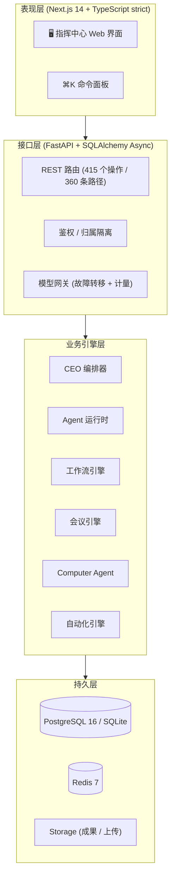

<div align="center">

# 🏢 AI-EOS

**AI 企业操作系统 —— 创建一家 AI 公司，雇佣数字员工，把工作交代下去**

[](#-最新动态v5150)
[](LICENSE)
[](https://www.python.org/)
[](https://fastapi.tiangolo.com)
[](https://nextjs.org/)
[](#-快速开始)
[](#-测试)

<p align="center">
  <b>一声令下，全公司为你开工</b><br>
  <i>One Command. A Whole Company at Work.</i>
</p>

[English](README.md) • **简体中文**

[✨ 核心功能](#-核心功能) • [🚀 快速开始](#-快速开始) • [🏗️ 系统架构](#-系统架构) • [🧪 测试](#-测试) • [📦 最新动态](#-最新动态v5140) • [📜 许可协议](#-许可与版权说明)

</div>

---

## 💡 为什么需要 AI-EOS？

AI 聊天机器人只会回答问题——活儿最后还是落在你自己桌上。与此同时：

1. **聊天机器人不干活**：它只生产文字，执行、跟进、协调全都还得你亲力亲为。
2. **真人团队太贵**：小企业主不可能为了提效就去养一个研究团队、一个内容团队、一个运营团队。
3. **Agent 工具都是单线程**：市面上多数"AI Agent"产品就是一个提示词输入框，没有组织、没有分工、没有审计链——你不敢把真活儿交给它。

**AI-EOS 不是聊天机器人，而是一个数字员工工作平台**：你创建一家 AI 公司，把数字员工（Agent）招进各个部门，给每个人设定岗位、模型和技能，然后下达任务。CEO Agent 会自动拆解任务、派给员工并行执行、组织讨论、汇总成果。你可以全程实时查看，随时暂停、介入、接管。

---

## ✨ 核心功能

### 1. 🏢 像管理真实公司一样管理 Agent
- **公司 → 部门 → 员工**：层级清晰的组织树，和真实企业一样。
- 每个员工都是完整档案：姓名、岗位、部门、上级、人格（System Prompt）、6 种状态（空闲 / 工作中 / 已暂停 / 异常 / 停用 / 在线）。
- **员工全生命周期**：模板招新、培训提案（审批 + 回滚）、绩效评估、晋升、转岗、离职交接。

### 2. 🤖 CEO 任务编排
- 在工作台（`/workspace`，首页）或指挥中心（`/dashboard`）下达一个任务，CEO Agent **自动拆解、并行派发、汇总成报告**。
- 支持批量下达（单个员工 / 名单 / 整个部门 / 全公司）、批量删除、批量改优先级、一键全局中断。
- **失败的任务可以重试**（`POST /tasks/{id}/retry`）；暂停能从检查点真恢复；重启后僵尸任务自愈。
- **CEO 会自己变强**：每天微调、每周复盘、每月迭代运行人格；每周由独立监督 Agent 出题考试（人格 / 成本纪律 / 决策 / 执行），老板可人工覆盖评分。
- **CEO 随时在手边**：任命即改名「CEO」并自动装配 10 项管理技能，解除后还原姓名、只收回专属技能；网页右下角常驻商务小人，桌面客户端还有透明置顶小人窗——点击或 `⌘⇧K / Ctrl+Shift+K` 随时对话，对话按线程永久保存，老段落压成摘要以节省 Token。
- **经验池**：成功路径固化成可复用工作流，失败教训跨员工共享；同类任务开工前自动注入，减少重试与 Token 浪费。

### 3. 👥 AI 会议系统
- 多轮次会议、用户随时插话、自动生成纪要，行动项一键转为任务。

### 4. 🖥️ Computer Agent（真实桌面自动化）
- 真实截屏、真实键入点击，全部经过安全沙箱 guardrail：二进制白名单、路径沙箱、危险命令默认只预演不执行。**当前仅 macOS 落地**（`screencapture` + `osascript` + `open`），Windows/Linux 的执行链路尚未接上。

### 5. 🔌 模型网关：故障转移 + 计量
- **首选 → 备选 → 兜底**多模型自动降级（OpenAI 兼容 / Anthropic / Gemini，另有插件目录可扩展）。
- **六维 Token 计量**（公司 / 部门 / 员工 / 项目 / 任务 / 场景）+ 成本快照——做成本分摊和报价的原材料。

### 6. 🧠 知识库、工作流画布与自动化
- 文档知识库检索——当前为**关键词重合度检索**（bigram 分词打分，SQL 层限制候选块数），**还不是向量/pgvector 语义检索**；`/knowledge/rag` 把检索到的片段注入 prompt，而非做 embedding 召回。另含拖拽式**工作流画布**（节点连线、运行实时轮询）与带定时触发的自动化引擎。

### 7. 🛡️ 认真的安全与隔离
- 登录限流（Redis，Redis 不可用时降级为进程内计数）、密码策略、bcrypt 哈希、**refresh token 轮换与吊销**、越权统一返回 404（防 ID 枚举）。
- **JWT 密钥绝不落在公开常量上**：`JWT_SECRET` 为空或仍是仓库里的占位值时，自动生成随机密钥并落盘（目录只读则降级为进程内随机密钥 + 大声告警）；生产环境（`AIEOS_ENV=production`）遇到不安全密钥**直接拒绝启动**，不静默兜底。
- **桌面版默认只监听 `127.0.0.1`**——局域网共享是显式开关，开启才绑 `0.0.0.0` 并重启后端（mDNS 广播同步联动）；`/docs`、`/redoc`、`/openapi.json` 仅在 `DEBUG=true` 时存在，`/metrics/prometheus` 需要 `METRICS_TOKEN` 或来自回环地址。
- Capability × 角色矩阵单一事实源，路由级归属校验。*说明：*矩阵定义了 OWNER/ADMIN/MEMBER/VIEWER，但**多成员协作尚未开放**——`resolve_role` 目前只对归属者返回 OWNER，所以今天的隔离粒度是「按用户」，不是共享组织的多租户。

### 8. 🎭 给人用的上手体验
- 四步引导向导（建公司 → 选服务商 → 填 Key → 绑定员工，约 1 分钟）、**免 Key 演示模式**（先体验再配模型）、中文可操作报错、带拼音搜索的 ⌘K 命令面板。向导可续装：填写内容存在 `sessionStorage`，模型已保存但连通测试失败时，刷新或重进会回到第 4 步继续修复。
- **所有功能都在同一张屏上**：`/workspace` 是唯一外壳，侧边栏 / ⌘K / 页面内跳转都以**右栏标签**打开功能页，
  对话和左栏原地不动；直接访问旧地址会自动回到工作台（标签可关闭、刷新可还原，窄屏下整屏展示）。

---

## 🏗️ 系统架构



**规模（v5.15.0 源码实测）**：后端 42,836 行 / 203 文件 / 408 条路径共 471 个操作 / 100 张表 / 39 个 Alembic 版本文件（历史 34 + 基线 0001–0005）；前端 39,463 行 / 51 个页面路由；后端测试 **781 项**（含 e2e 38 项）。

> 两条如实说明，因为"能跑"和"验证过"不是一回事：
> - **`alembic upgrade head` 只支持 PostgreSQL。** 历史迁移 `23e9b97bb927` 在 SQLite 上会抛
>   `No support for ALTER of constraints`。桌面/便携形态不依赖 Alembic——它的 schema 演进走
>   `create_all` + 幂等 `ensure_columns`，老 SQLite 库首次启动即自动补齐；只有服务器部署（Postgres）走 Alembic。
> - **`plugins/skills/`、`plugins/providers/`、`plugins/models/` 与 `packages/*` 目前都是空目录。**
>   动态加载的**代码是真实存在且会执行的**，但仓库尚未内置任何插件——别用"已安装插件列表"来判断扩展系统。

---

## 🚀 快速开始

### 环境要求
- **Python**：3.12+
- **Node.js**：18+（前端）
- **操作系统**：macOS / Linux / Windows
- **可选**：PostgreSQL 16 + Redis 7（docker compose 已配好；SQLite 开箱即用）

### 本地启动

```bash
# 1. 克隆
git clone https://github.com/yimuhub/ai-eos.git
cd ai-eos

# 2. 配置（复制模板并填入你的模型 API Key）
cp .env.example apps/api/.env

# 3. 后端
cd apps/api
uv sync
uv run uvicorn app.main:app --host 127.0.0.1 --port 8001

# 4. 前端（新开一个终端）
cd apps/web
npm install
npm run dev
```

打开 **`http://localhost:3000`**，在登录页**注册一个账号**即可使用（没有预置账号，第一次注册的就是你的）。

> 💡 还没有 API Key？引导向导提供**免 Key 演示模式**（1 个演示员工 + 1 个示例任务），先感受产品再配模型。

### 📦 便携启动（双击即用）

- **macOS**：双击 `packaging/start-mac.sh`（首次自动装依赖，启动前自动快照 `data/`）
- **Windows**：双击 `packaging/start-win.bat`
- **Linux**：终端执行 `./packaging/start-linux.sh`（与 macOS 同标准：自动装依赖、快照 `data/`、日志追加）

### 🐳 Docker

```bash
cd docker && docker compose up -d
```

### 🌐 服务器一键部署

在全新的 Linux 服务器上（Ubuntu / Debian / CentOS / Rocky / Alpine）：

```bash
git clone https://github.com/yimuhub/ai-eos.git
cd ai-eos
chmod +x 服务器一键部署.sh && ./服务器一键部署.sh
```

脚本会自动安装系统依赖、拉取代码（仓库是私有的——请提前准备好 GitHub personal access token）、
配置后端（`uv sync`、自动生成带随机 `JWT_SECRET` 的 `.env`、`alembic upgrade head`）与前端
（`npm install && npm run build`），然后注册并启动 `ai-eos-api` / `ai-eos-web` 两个 systemd 服务。
完成后打开 `http://<服务器IP>:8000` 即可使用。

---

## 🧪 测试

```bash
cd apps/api && uv run pytest        # 后端 171 通过、1 跳过
cd apps/web && npm run test          # 前端 vitest
```

> ⚠️ 跑 `test_auth.py` 时**不要启动本地 Redis**——该测试断言的是内存限流字典，起了 Redis 会走 Redis 通道导致断言失败。

---

## 📦 最新动态：v5.15.0

*从审查到九分：契约、交付、多端与安全收口 — 2026-11-01。完整记录见 [`CHANGELOG.md`](CHANGELOG.md)。*

- 🛡 **接口契约稳定。** 所有错误统一为 `{detail, code, message, request_id}`，`/api/v1` 与原路径等价；核心业务路由（员工/任务/项目/交付/评审/调度/技能/学习/绩效/反思）的 2xx 操作 **90%** 声明了 `response_model`（113 个模型类），棘轮测试防止回退；全库 113/471。
- 🧾 **交付闭环。** 交付物关联任务、验收/退回（幂等）、评论；任务收件箱四桶（进行中/待验收/完成/失败），「提交 → 验收」成为真实流程。
- 📱 **多端可用。** `/m` PWA 审批、Web Push（订阅表 + VAPID + 404/410 清理）、跨设备已读同步（`thread_reads`，只增不减）。
- 🏭 **一键建公司。** SaaS 行业包（5 部门 / 13 角色 / 3 交付物模板 / 10 任务模板）整包脚手架；本地混合检索（CJK bigram + 同义词 + BM25）驱动 ⌘K。
- 💳 **商业化底座。** 14 天试用与套餐、可打印 HTML 账单、Fernet 加密 BYOK 密钥库、Ed25519 License + 全局只读闸门。
- 🧪 **质量。** 后端 **781 项**、行覆盖 **69.8%**（此前的 47.9% 是测量错误——coverage 没追踪 greenlet）、Lighthouse 首屏门禁、60 条评测集、依赖/密钥扫描与租户矩阵（发布前手动流水线）。
- 🚀 **运维。** Dockerfile + compose、带 sha256 校验演练的备份/恢复，以及「云端 + 本地」双端备份方案（[`docs/备份与恢复.md`](docs/备份与恢复.md)）。
- ⚙️ **CI 策略调整。** 密集开发期不再随 push 自动跑 CI / 安全扫描 / 客户端打包（节省 Actions 额度），发布前在 Actions 页面手动触发；更新记录仍由提交、标签、CHANGELOG 与 Release 承担。

### 上一轮：v5.14.0

*两套界面、同一个系统：经典整页导航与极客三栏工作台，首次进入自己选 — 2026-10-30。完整记录见 [`CHANGELOG.md`](CHANGELOG.md)。*

- 🎛 **首次进入二选一。** 经典 = 左侧固定菜单 + 整页导航，一页一件事；极客 = `/workspace` 三栏对话 + 右栏标签。两边功能完全相同，只换用法；Esc 关不掉，必须选一个。
- 🖥 **经典模式恢复原来那一套。** 固定左栏（分组折叠、⌘K 搜索、最近访问、模式切换、退出登录），点功能整页进入，地址栏就是页面本身；`/` 落到指挥中心。
- 🧠 **极客模式保持三栏。** 左「员工 / 会话」、中「对话」、右「产出 + 功能标签」，切换标签不丢列表筛选与滚动位置，刷新整组标签还原。
- 🔀 **切换会带着当前页走。** ⌘K 或两侧栏底部的 ⇄ 都能切：经典 → 极客把当前页作为右栏标签带进工作台；极客 → 经典把当前标签的页面整页打开。模式和选择都留在本机。
- 🧪 后端 **324 项用例通过**；`./tools/check.sh --fast` 全绿（契约 / tsc strict / eslint），`next build` 47 个页面全出；浏览器走查覆盖首次强制选择、两种模式导航、双向切换落点、刷新持久化与直达链接改写。

### 上一轮：v5.13.0

*一个界面、逐字答复：所有功能都开在工作台的右栏标签里 — 2026-10-30。完整记录见 [`CHANGELOG.md`](CHANGELOG.md)。*

- 🧩 **所有功能都在同一张屏上。** `/workspace` 成为唯一外壳：左栏、⌘K、页面内入口一律把功能页开成**右栏标签**，对话与左栏原地不动、不再整页跳走。标签常驻（筛选与滚动位置保留），关掉当前标签落到左边那个，刷新后原样还原。
- 🔗 **旧地址照样能用。** 直接访问 `/tasks`、`/knowledge` 等会改写到 `/workspace?app=…`，书签、刷新、粘贴的链接都落回同一个界面；窄屏下面板整屏展示，左抽屉自动让位。
- ⌨️ **快捷键不再被吞。** 焦点落进内嵌页面时，`⌘K` / `⌘B` / `⌘J` / `⌘N` 由内层转给外壳处理，命令面板在哪儿按都一样。
- 🌊 **聊天逐字输出。** 新增 `POST /agents/{id}/chat/stream`（SSE 四类帧 `status` / `delta` / `done` / `error`）；网关 `stream()` 在服务端不支持 `stream_options` 时自动降级，且只在**首个 token 之前**才换模型重试，避免两个模型的文本拼在一起。工作台对话与员工详情对话都改为逐字渲染，带闪烁光标、停止按钮和「本轮未保存到历史」的如实提示。
- 🚚 **路由与桌面壳。** 原指挥中心搬到 `/dashboard`；mac 桌面壳改 `hiddenInset` + 34px 拖拽区。旧的全局侧边栏外壳已删除，只保留一套导航。
- 🧪 后端 **324 项用例通过**；`./tools/check.sh --fast` 全绿（契约 / tsc strict / eslint），`next build` 47 个页面全出，另有浏览器走查覆盖标签流、直达改写、刷新还原与 390px 布局。

### 上一轮：v5.12.0

*「一人公司」主线打通：一句话 → 全公司开工 → 拿到结果 — 2026-10-29。完整记录见 [`CHANGELOG.md`](CHANGELOG.md)。*

- 👑 **一句话直达。** 新增 `POST /command/run`：解析与执行一次完成，不再需要中间确认。DIRECT 路径任务创建即入队执行；PROJECT 路径跳过逐人宣告与负责人校对，直接确认分工开工。指挥台新增「⚡ 一句话直达」按钮，「先看方案」保留原两步式。
- 🚀 **派活真的会开工。** 修复"一键派给全公司"只产出 N 条永远不动的待办：新增 `auto_start` 标记 + 持久化排队（`app/task_runner.py`），CAS 启动、worker 池满自动退回待办并保留标记，调度循环每拍按紧急/高/普通优先级拉起——不会留下 RUNNING 但没有 worker 的僵尸行。
- 🔧 **Agent 真的能取数。** 任务执行链首次真正下发工具（`web_search` / `web_fetch`，OpenAI function-calling + 弱模型文本兜底），多轮调用、结果截断回填、`tools_used` 进度留痕；能力包里"会网页浏览"不再只是提示词幻觉。
- 📊 **报表与报告能交付。** 内置 5 类专业报告骨架（行业研究/经营分析/周报/项目复盘/方案书）；Word 渲染真实表格与中文字体，Excel 多 Sheet + 数值类型 + 冻结首行 + 筛选，PPT 原生表格与分页。
- 🕘 **简报数字对齐时区。** 晨间简报的"昨日/今日/今日成本"改按本地自然日换算 naive UTC；顺带修掉一个引用不存在字段的 500（非属主请求 `company.created_by`）。
- 🛡 **收口。** 自动化 `call_webhook` 补 SSRF 闸门（含连接后对端复核）；任务派活按公司过滤，跨租户派活不再可能。
- 🧪 新增 34 个后端用例（文档渲染、自动排队、工具循环、一句话直达、简报、webhook SSRF），测试总数 261 → **295**；`./tools/check.sh` 全绿（契约 / tsc / eslint / e2e 38 项）。

### 上一轮：v5.11.0

*按技术方向复审后的第二轮加固 — 2026-10-28。*

完整记录见 [`CHANGELOG.md`](CHANGELOG.md)，复审报告见 [`docs/审查报告_AI-EOS_2026-10-28.md`](docs/审查报告_AI-EOS_2026-10-28.md)。

- 🚪 **越权读彻底清零。** 15 个此前"探针确认真的能读到"的端点（专家库、协作消息、定时任务、记忆、治理、技能、自动化、考核周期）全部补上归属校验；52 条静态债务登记表压到 **1 条已知误报**，护栏同时学会识别 router 级 `require_company_scope`。
- ⚙️ **并发正确性。** SQLite `busy_timeout`/WAL/外键、审批决策与任务状态迁移改 CAS、"先提交再投递"、会议/工作流租约，并发 20 请求不再出现 `database is locked` 或副作用执行两次。
- 🌐 **出站安全。** 模型配置不能再引用 `JWT_SECRET` 之类的服务端变量（写入侧拦截 + **运行时兜底**，历史遗留行也取不到值）；SSRF 改为逐跳校验；webhook/网页抓取不回显上游响应体。
- ⚡ **性能。** 首页三个串行请求合并为 `/dashboard/{id}/bootstrap`（计数改 `GROUP BY`、活跃任务 `limit 20`、轮询 5s→15s）；任务详情轮询改 `/tasks/{id}/summary`（不传 `result` 全文、输出截断 2KB）；作战室改增量快照；RAG 先收窄候选集再精排；群聊显式 `max_tokens=512` + 按公司限流。
- 📤 **上传与插件。** 1MB 块流式落盘 + 25MB 上限 + 扩展名白名单 + 服务端生成文件名；技能插件去掉 `sys.path.insert`，改为唯一模块名加载并校验 manifest/路径。
- 🧪 **测试有效性。** 覆盖率门禁进 CI（路由+核心层 35%，阈值 30）、lifespan 首次被真实执行、护栏加反向验证；测试总数 171 → **261**。

### 上一轮：v5.10.0

*安全与正确性加固 — 2026-10-27。*

完整记录见 [`CHANGELOG.md`](CHANGELOG.md)，催生这一轮的检测报告见
[`docs/检测报告_AI-EOS_2026-10-27.md`](docs/检测报告_AI-EOS_2026-10-27.md)。
下面每一项都是**先复现、再修复、再用攻击实测回归**——不是"看完代码顺手打个补丁"：

- 🔑 **JWT 空密钥/公开密钥可伪造 token。** 空密钥照样能签出合法 token，也照样能校验通过。现在自动生成并落盘随机密钥；生产环境遇到不安全密钥直接拒绝启动。用 `""` 与仓库里的占位值伪造：**5/5 全部拒绝**。
- 🚪 **跨租户读越权。** 写路径本来有校验，**读路径几乎没有**——带上别人的 `company_id` 就能列出对方成果、知识库文档、审批策略与白名单。现在 **31/31 攻击实测全部拦截、属主 0 误伤**，并新增 AST 护栏测试 + 一份**只许缩小**的存量债务登记表。
- 🗄 **SQLite 上"发布"从来没成功过。** `SET published_at = NOW()`（SQLite 无此函数），而模型里**压根没有 `published_at` 这一列**。改为绑定参数 + naive UTC；列进模型、进 Alembic 迁移、并在启动时幂等补列。`提交 → 审核通过 → 发布` 全链路实测通过且幂等。
- 🖥 **桌面版过去无条件监听 `0.0.0.0`。** 现在默认 `127.0.0.1`，局域网共享改成显式开关（同时联动 mDNS 广播）；`/docs` 与 `/openapi.json` 只在 `DEBUG` 下存在；`/metrics` 需要令牌或回环来源。
- ⚙️ 预算恢复大小写不匹配（提高上限也恢复不了工作）、naive/aware UTC 混用导致当日统计失真、工作流 Agent 节点失败被当成"等待人工"永远挂着、会议纪要抽取的死代码、阻塞 `urlopen` 改异步，以及**静默 `except: pass` 清零**。
- 🧨 版本号在六个地方六个值（`0.1.0` / `5.9.0` / `5.0.0` / `4.1.0` / `5.4`）——现在单一来源 + 一致性测试。
- 🛡 新增 CI 门禁：后端 pytest（**明确不起 Redis**——`test_auth` 断言的是内存回退字典）、`tsc --noEmit`、vitest，以及收紧后的 OpenAPI 契约检查（拼错的动作名不再绿灯放行）。

### Phase 3 + 2026-10-14 加固

**Phase 3** 落地了员工成长体系（学习、绩效评估、技能市场、外部 Agent 接入、Computer Agent）。

**2026-10-14 加固**（详见 `CHANGELOG.md`）修复了独立五视角代码审查的全部 P0 项：

- 🔁 任务重试端点、检查点真恢复、僵尸任务自愈、按类型拆分超时（告别 600 秒死亡线）
- 🔌 网关熔断 + 冷却、故障转移日志、失败计入计量
- 🔑 refresh token 轮换与吊销、Redis 登录限流、AST 级静默异常门禁
- 🧩 `plugins/skills/` 与 `plugins/providers/` 真动态加载
- 📦 启动器修复、`.env.example`、备份手册、生产级 Docker compose
- ⚖️ 采用 **BSL 1.1** 许可

---

## 📜 许可与版权说明

- **版权方与 Licensor**：eos.hyipf.com
- **许可证**：**Business Source License 1.1（BSL 1.1 / BUSL-1.1）**

### 📄 商业条款与使用授权
- 🎁 **免费层**：个人学习、研究；非商业用途；以及**团队规模不超过 3 人的团队内部使用**——完全免费，无需授权。
- 💼 **商业授权**：超出免费层范围的使用，包括**团队规模超过 3 人使用**，或**部署于云端/公网服务器、以 SaaS 形式对外提供服务**，需获得商业授权（登记请联系 `eos@hyipf.com`）。
- 🔄 **自动转开源**：每版发布满 4 年，自动转为 **Apache License 2.0**。

完整法律文本请阅读 [LICENSE](LICENSE)。

---

<div align="center">
  <sub>Copyright © 2026 eos.hyipf.com · All rights reserved.</sub>
</div>
