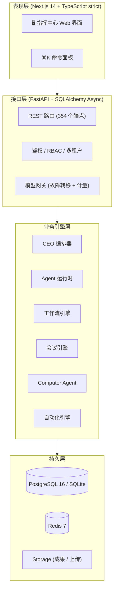

<div align="center">

# 🏢 AI-EOS

**AI 企业操作系统 —— 创建一家 AI 公司，雇佣数字员工，把工作交代下去**

[](#-最新动态phase-3--2026-10-14-加固)
[](LICENSE)
[](https://www.python.org/)
[](https://fastapi.tiangolo.com)
[](https://nextjs.org/)
[](#-快速开始)
[](#-测试)

<p align="center">
  <b>一声令下，全公司为你开工</b><br>
  <i>One Command. A Whole Company at Work.</i>
</p>

[English](README.md) • **简体中文**

[✨ 核心功能](#-核心功能) • [🚀 快速开始](#-快速开始) • [🏗️ 系统架构](#-系统架构) • [🧪 测试](#-测试) • [📦 最新动态](#-最新动态phase-3--2026-10-14-加固) • [📜 许可协议](#-许可与版权说明)

</div>

---

## 💡 为什么需要 AI-EOS？

AI 聊天机器人只会回答问题——活儿最后还是落在你自己桌上。与此同时：

1. **聊天机器人不干活**：它只生产文字，执行、跟进、协调全都还得你亲力亲为。
2. **真人团队太贵**：小企业主不可能为了提效就去养一个研究团队、一个内容团队、一个运营团队。
3. **Agent 工具都是单线程**：市面上多数"AI Agent"产品就是一个提示词输入框，没有组织、没有分工、没有审计链——你不敢把真活儿交给它。

**AI-EOS 不是聊天机器人，而是一个数字员工工作平台**：你创建一家 AI 公司，把数字员工（Agent）招进各个部门，给每个人设定岗位、模型和技能，然后下达任务。CEO Agent 会自动拆解任务、派给员工并行执行、组织讨论、汇总成果。你可以全程实时查看，随时暂停、介入、接管。

---

## ✨ 核心功能

### 1. 🏢 像管理真实公司一样管理 Agent
- **公司 → 部门 → 员工**：层级清晰的组织树，和真实企业一样。
- 每个员工都是完整档案：姓名、岗位、部门、上级、人格（System Prompt）、6 种状态（空闲 / 工作中 / 已暂停 / 异常 / 停用 / 在线）。
- **员工全生命周期**：模板招新、培训提案（审批 + 回滚）、绩效评估、晋升、转岗、离职交接。

### 2. 🤖 CEO 任务编排
- 在指挥中心下达一个任务，CEO Agent **自动拆解、并行派发、汇总成报告**。
- 支持批量下达（单个员工 / 名单 / 整个部门 / 全公司）、批量删除、批量改优先级、一键全局中断。
- **失败的任务可以重试**（`POST /tasks/{id}/retry`）；暂停能从检查点真恢复；重启后僵尸任务自愈。

### 3. 👥 AI 会议系统
- 多轮次会议、用户随时插话、自动生成纪要，行动项一键转为任务。

### 4. 🖥️ Computer Agent（真实桌面自动化）
- 真实截屏、真实键入点击，全部经过安全沙箱 guardrail：二进制白名单、路径沙箱、危险命令默认只预演不执行。

### 5. 🔌 模型网关：故障转移 + 计量
- **首选 → 备选 → 兜底**多模型自动降级（OpenAI 兼容 / Anthropic / Gemini，另有插件目录可扩展）。
- **六维 Token 计量**（公司 / 部门 / 员工 / 项目 / 任务 / 场景）+ 成本快照——做成本分摊和报价的原材料。

### 6. 🧠 知识库、工作流画布与自动化
- 文档知识库检索；拖拽式**工作流画布**（节点连线、运行实时轮询）；带定时触发的自动化引擎。

### 7. 🛡️ 认真的安全与多租户
- 登录限流（Redis）、密码策略、bcrypt 哈希、**refresh token 轮换与吊销**、越权统一返回 404（防租户 ID 枚举）。
- Capability × 角色矩阵单一事实源，路由级归属校验。

### 8. 🎭 给人用的上手体验
- 三步引导向导（约 1 分钟）、**免 Key 演示模式**（先体验再配模型）、中文可操作报错、带拼音搜索的 ⌘K 命令面板。

---

## 🏗️ 系统架构



**规模（源码实测）**：后端约 21,500 行 / 135 文件 / 354 端点 / 94 张表 / 28 个 Alembic 迁移；前端约 17,700 行 / 34 个一级页面；后端测试 158 用例。

---

## 🚀 快速开始

### 环境要求
- **Python**：3.12+
- **Node.js**：18+（前端）
- **操作系统**：macOS / Linux / Windows
- **可选**：PostgreSQL 16 + Redis 7（docker compose 已配好；SQLite 开箱即用）

### 本地启动

```bash
# 1. 克隆
git clone https://github.com/yimuhub/ai-eos.git
cd ai-eos

# 2. 配置（复制模板并填入你的模型 API Key）
cp .env.example apps/api/.env

# 3. 后端
cd apps/api
uv sync
uv run uvicorn app.main:app --host 127.0.0.1 --port 8001

# 4. 前端（新开一个终端）
cd apps/web
npm install
npm run dev
```

打开 **`http://localhost:3000`**，在登录页**注册一个账号**即可使用（没有预置账号，第一次注册的就是你的）。

> 💡 还没有 API Key？引导向导提供**免 Key 演示模式**（1 个演示员工 + 1 个示例任务），先感受产品再配模型。

### 📦 便携启动（双击即用）

- **macOS**：双击 `packaging/start-mac.sh`（首次自动装依赖，启动前自动快照 `data/`）
- **Windows**：双击 `packaging/start-win.bat`
- **Linux**：终端执行 `./packaging/start-linux.sh`（与 macOS 同标准：自动装依赖、快照 `data/`、日志追加）

### 🐳 Docker

```bash
cd docker && docker compose up -d
```

### 🌐 服务器一键部署

在全新的 Linux 服务器上（Ubuntu / Debian / CentOS / Rocky / Alpine）：

```bash
git clone https://github.com/yimuhub/ai-eos.git
cd ai-eos
chmod +x 服务器一键部署.sh && ./服务器一键部署.sh
```

脚本会自动安装系统依赖、拉取代码（仓库是私有的——请提前准备好 GitHub personal access token）、
配置后端（`uv sync`、自动生成带随机 `JWT_SECRET` 的 `.env`、`alembic upgrade head`）与前端
（`npm install && npm run build`），然后注册并启动 `ai-eos-api` / `ai-eos-web` 两个 systemd 服务。
完成后打开 `http://<服务器IP>:8000` 即可使用。

---

## 🧪 测试

```bash
cd apps/api && uv run pytest        # 后端 158 个测试用例
cd apps/web && npm run test          # 前端 vitest
```

> ⚠️ 跑 `test_auth.py` 时**不要启动本地 Redis**——该测试断言的是内存限流字典，起了 Redis 会走 Redis 通道导致断言失败。

---

## 📦 最新动态：Phase 3 + 2026-10-14 加固

**Phase 3** 落地了员工成长体系（学习、绩效评估、技能市场、外部 Agent 接入、Computer Agent）。

**2026-10-14 加固**（详见 `CHANGELOG.md`）修复了独立五视角代码审查的全部 P0 项：

- 🔁 任务重试端点、检查点真恢复、僵尸任务自愈、按类型拆分超时（告别 600 秒死亡线）
- 🔌 网关熔断 + 冷却、故障转移日志、失败计入计量
- 🔑 refresh token 轮换与吊销、Redis 登录限流、AST 级静默异常门禁
- 🧩 `plugins/skills/` 与 `plugins/providers/` 真动态加载
- 📦 启动器修复、`.env.example`、备份手册、生产级 Docker compose
- ⚖️ 采用 **BSL 1.1** 许可

---

## 📜 许可与版权说明

- **版权方与 Licensor**：eos.hyipf.com
- **许可证**：**Business Source License 1.1（BSL 1.1 / BUSL-1.1）**

### 📄 商业条款与使用授权
- 🎁 **免费层**：个人学习、研究；非商业用途；以及**团队规模不超过 3 人的团队内部使用**——完全免费，无需授权。
- 💼 **商业授权**：超出免费层范围的使用，包括**团队规模超过 3 人使用**，或**部署于云端/公网服务器、以 SaaS 形式对外提供服务**，需获得商业授权（登记请联系 `eos@hyipf.com`）。
- 🔄 **自动转开源**：每版发布满 4 年，自动转为 **Apache License 2.0**。

完整法律文本请阅读 [LICENSE](LICENSE)。

---

<div align="center">
  <sub>Copyright © 2026 eos.hyipf.com · All rights reserved.</sub>
</div>
